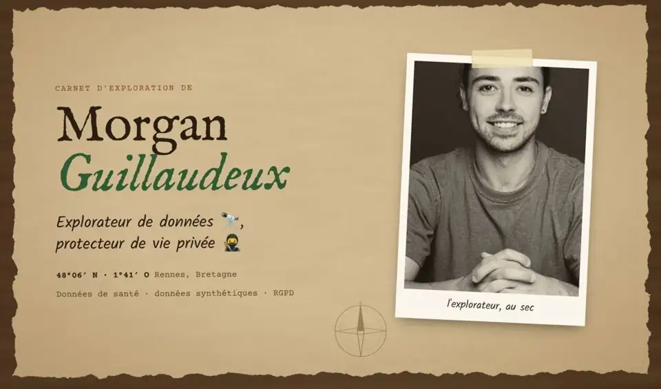

  <a href="https://mguillaudeux.github.io"><b>📖 Ouvrir le carnet complet / Open the full notebook</b></a>
  &nbsp;·&nbsp;
  <a href="https://fr.linkedin.com/in/morgan-guillaudeux-331275173">LinkedIn</a>

### 🐙 Salut, moi c'est Morgan !

Si je devais choisir un animal totem, ce serait la pieuvre : polyvalente, curieuse, touche-à-tout.
J'explore les données de santé, je les rends partageables sans exposer personne (données synthétiques, anonymisation), et j'adore transmettre ce que j'apprends.

- 🔬 Analyse avancée de données biomédicales · Python, R, SQL
- 🥷 Données synthétiques, anonymisation, RGPD (DPO)
- 🎤 Conférences, vulgarisation, accompagnement client
- 📍 Rennes, Bretagne · ingénieur agronome, maths appliquées, biologie

🇬🇧 In English

If I had to pick a spirit animal, it would be the octopus: versatile, curious, a bit of everything.
I explore health data, make it shareable without exposing anyone (synthetic data, anonymisation), and I love passing on what I learn.

- 🔬 Advanced biomedical data analysis · Python, R, SQL
- 🥷 Synthetic data, anonymisation, GDPR (DPO)
- 🎤 Talks, science communication, customer success
- 📍 Rennes, Brittany · agronomy engineer, applied maths, biology

### 📜 Spécimens publiés / Publications

| Année | Publication | Rôle |
| --- | --- | --- |
| 2025 | [Privacy-by-Design Approach to Generate Two Virtual Clinical Trials for Multiple Sclerosis and Release Them as Open Datasets](https://www.jmir.org/2025/1/e71297) · *J Med Internet Res* | Co-auteur |
| 2023 | [Patient-centric synthetic data generation, no reason to risk re-identification in biomedical data analysis](https://www.nature.com/articles/s41746-023-00771-5) · *npj Digital Medicine* | **Premier auteur** |
| 2023 | [Notebook pédagogique : générer et évaluer des données synthétiques en santé](https://gitlab.com/healthdatahub/se-former-au-snds/tutoriel-generation-de-donnees-synthetiques-en-sante) · *Health Data Hub* | Co-auteur |
| 2019 | [How Different Tangible and Virtual Objects Can Be While Still Feeling the Same?](https://hal.science/hal-02121839) · *IEEE World Haptics* | Co-auteur |

### 🧭 Escales récentes / Recent talks

- **Oct. 2026** · Comment évaluer techniquement le caractère anonyme d'une donnée · AFCDP, GT Santé, Paris
- **Mars 2026** · Predict Trial Outcomes before the End of Patient Recruitment · EURAICA 2026, Bruxelles
- **Nov. 2025** · Cas pratique d'anonymisation, du traitement jusqu'à son évaluation · AFCDP, en ligne
- **Mai 2025** · How to Produce and Evaluate Synthetic Data · Synthetic Data Summit, Montréal
- **Oct. 2024** · Anonymisation, pseudonymisation, données synthétiques · European Health Data Protection Congress, Paris

### 🗺️ Expéditions en cours / Ongoing expeditions

Petits projets publics en préparation : ils apparaîtront ici au fil de l'eau.
*Small public projects are on their way and will show up here.*
